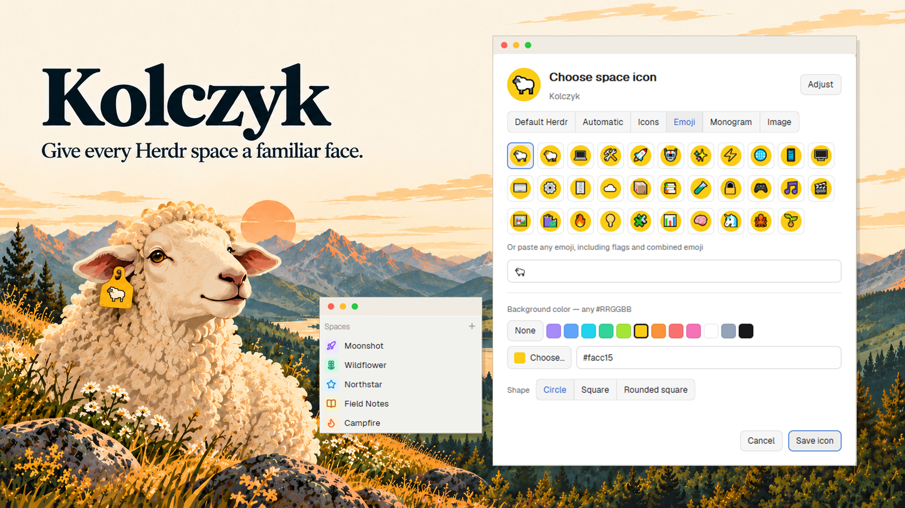
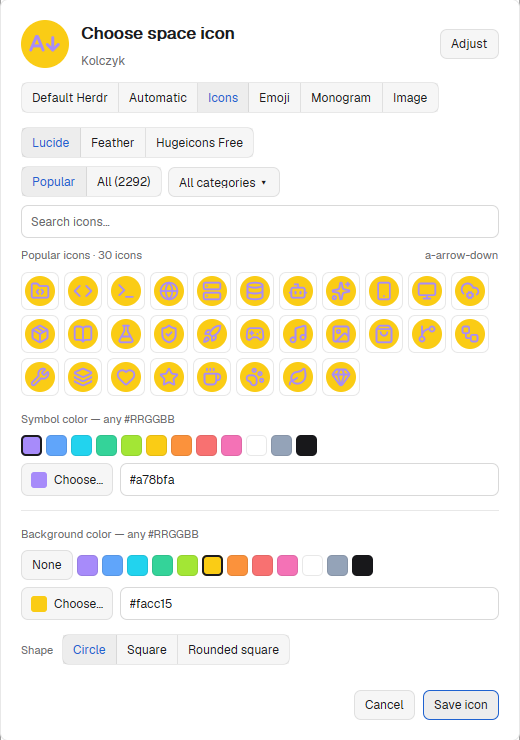
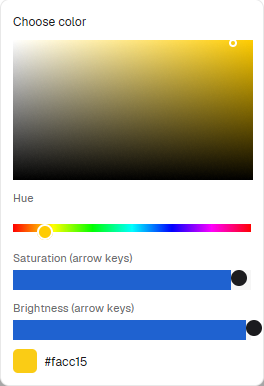

# Kolczyk - Space icons

**Give each space its own icon and color. Find the right one at a glance.**

Kolczyk is a native Herdr mod that puts project icons, emoji and little personal
touches in your spaces sidebar. Right-click a space, choose **Change icon…**,
and make it easier to spot among the rest of your work.



*A real native picker screenshot, arranged for presentation.*

## A small detail, your way

- **Let the project introduce itself.** Automatic finds a local project favicon
  and falls back to initials when there isn't one.
- **Pick a symbol.** Browse Lucide, Feather and Hugeicons Free, with offline
  search, categories and a Popular shortlist. Or use an emoji, a one- or
  two-character monogram, or your own image.
- **Make it fit.** Choose colors and a circle, square or rounded-square
  background. Adjust the symbol's size and position while previewing it at
  sidebar size.
- **Keep it familiar.** The picker follows Herdr's theme and works with both
  the full sidebar and compact rail. **Default Herdr** restores the stock marker.

Everything is rendered with native GPUI controls. Icon libraries are bundled;
Kolczyk makes no runtime network requests. Changes stay in a draft until you
choose **Save icon**; **Cancel** or **Esc** discards them.

## Install

The base mod uses Herdr's built-in JavaScript runtime. **No Node.js or
PowerShell is required** for Icons, Emoji, Monogram, backgrounds, colors or
Adjust. The code targets Windows, Linux and macOS; native acceptance has
currently been performed on Windows only.

Download or clone this repository. Ask your coding agent to install it:

```text
Read ~/.config/herdr-app/AGENTS.md and this repository's RECIPE.md.
Install mods/kolczyk into my Herdr app home. Back up my personal layout and
any previous Kolczyk installation. Clone my layout first if it is shipped.
Change only the existing spaces block's content.mod to kolczyk. Preserve
all other blocks and settings. Run herdr-app check on the installed mod.
Do not install the optional Node helper unless I ask for Automatic/Image.
```

An optional Windows installer is also available:

```powershell
powershell.exe -NoProfile -ExecutionPolicy Bypass -File scripts/install.ps1 -Layout custom
```

Kolczyk replaces the `spaces` block's mod in that layout. It includes a personal
copy of Herdr's space list and context menu, based on **spaces 0.1.11**, so new
upstream sidebar features do not arrive automatically. It depends on stock
Herdr commands, `workspace-chrome` assets and `worktree` dialogs. The installer
backs up the existing layout and mod, preserves other layout nodes, and refuses
to replace an unrelated spaces mod. Changes apply without restarting Herdr.

### Optional: Automatic and Image

These modes need **Node.js 22+ and the optional helper package**. Node alone is
not enough: install the helper dependencies once. In the **installed**
`mods/kolczyk/node-helper` directory under your Herdr app home, run:

```sh
npm ci --omit=dev
```

Close the picker while installing, then reopen it or choose **Check again**.
The helper works on Windows, Linux and macOS. Nothing is downloaded during
normal use. Without it, Automatic/Image explain the missing setup and the other
modes remain available. Previously imported images continue to render without
Node. Automatic icons fall back to initials when the helper is unavailable.

You can customize remote spaces manually; Kolczyk does not fetch remote
favicons. See the [optional helper](mods/kolczyk/node-helper/README.md).

See the **[usage guide](docs/usage.md)** for discovery rules, image limits,
keyboard controls, backups and removal.

## A closer look

| Browse the bundled icon libraries | Pick any color visually |
| --- | --- |
|  |  |

## Why “Kolczyk”?

*Kolczyk* is Polish for an earring—and for an animal's ear tag. Herdr has a
flock; this mod gives each sheep a recognizable tag. A small mark to help you
find the space you meant.

## Credits

Inspired by [T3code's project icon picker](https://github.com/pingdotgg/t3code/blob/main/apps/web/src/components/settings/ProjectIconPickerDialog.tsx)
and [favicon resolver](https://github.com/pingdotgg/t3code/blob/main/apps/server/src/project/ProjectFaviconResolver.ts).
Bundled icons come from **Lucide** (ISC), **Feather** (MIT) and **Hugeicons Free**
(MIT). License files are included in [`mods/kolczyk`](mods/kolczyk).
See [sources and licenses](docs/usage.md#sources-and-licenses) for versions and
metadata attribution.

Kolczyk is licensed under [Apache 2.0](LICENSE). It includes modified Herdr
sidebar code; see [NOTICE](NOTICE). Bundled icons retain their respective licenses.

Maintainers: see the [publication guide](docs/publishing.md).
