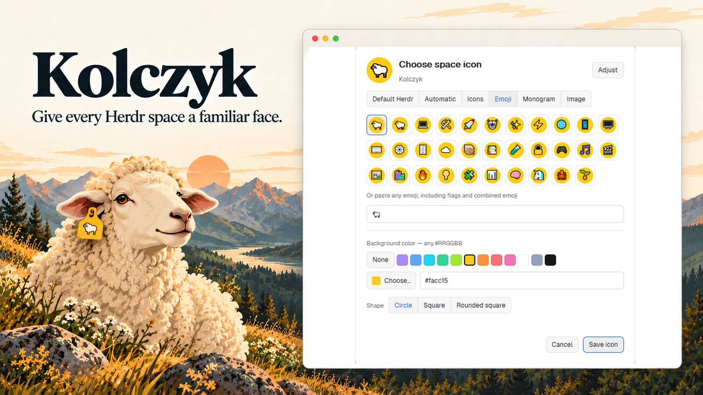

# Kolczyk — Give every Herdr space a familiar face

A native Herdr space-icon picker. Right-click a space, choose **Change icon…**,
then select Default Herdr, Automatic, a Lucide, Feather or Hugeicons icon, emoji, monogram or imported
image. Every custom type can sit on a colored circle, square or rounded square.

## What you see

The sidebar preserves the stock space names, worktree hierarchy, git suffixes
and machine groups, with a 22px avatar (18px for nested worktrees). The compact
rail uses a 20px avatar and the existing attention dot. Right-click opens a
220px menu. The 520px-wide dialog adapts its height by mode and visible catalogue rows (290–907px, capped to the viewport), with a 48px preview, six mode buttons, scrollable
content and Cancel / Save at the bottom. It uses the current Herdr theme.

Icons offer Lucide (2292), Feather (287) and Hugeicons Free (6144), with Popular
and All views and search, with 66 results per page and 11 columns. A searchable
category Popover filters the offline upstream metadata; resolve Lucide's
`$extends:` references and intersect with installed SVG names. Feather uses
matching Lucide names, falling back to Other. Each tile previews the chosen
background; light symbols without a background get a dark catalogue-only backing.
Emoji has 32 quick choices plus free
input. Monogram accepts one or two letters or numbers. Image offers up to 200
project paths, an arbitrary local path and file drop. Every mode offers twelve
color swatches, free hex input, no background, and three shapes.

## How it behaves

Default Herdr restores the shipped single-initial colored 18px tile, the compact
rail number, and the branch-only worktree marker. Use the shared `space.colors`
palette rather than the custom background. Save a minimal `{kind: "herdr"}`
record to distinguish stock rendering from Automatic and remove custom fields;
Cancel must retain the previous record. Hide background/adjust controls in this mode.

Click selects a space; drag reorders within its machine; right-click retains
Rename, worktree commands and Close, adding Change icon. Menu arrows and Enter
work as in stock Herdr; Escape closes overlays. Blocked/done attention uses the
stock compact-rail dot; working/idle keeps stock styling. Save merges only the
selected space's choice into fresh shared state. Cancel/Escape discards drafts.
Choosing another icon type preserves its background and foreground settings.

Automatic scans the live local project and falls back to fresh name-derived
initials. It follows folder changes, refreshes at most once a minute in an active
window, and can be refreshed explicitly. Remote spaces support manual choices;
their favicons are not fetched by the local helper.

## Built from

One mod `kolczyk`, installed into the existing personal layout's `spaces` block.
Render the sidebar directly at the mod root: Herdr invalidates that root on
shared-state changes, whereas a retained child can keep its old icon description
until a mouse event invalidates it. Keep retained views only for picker/menu roles.
`main.js` routes `props.mode` to sidebar (`spaces.js`), menu (`menu.js`) or picker
(`picker.js`). Menu props follow stock `{tab, target}`; picker uses `{space}`.
`avatar.js` paints the shared appearance model; `model.js` validates choices;
`assets.js` calls optional `node-helper/main.mjs` with `exec('node', ...)`.
Without Node or its package dependencies, manual modes work and Automatic/Image
show setup instructions. Imported images remain renderable. No runtime PowerShell.

Uses Herdr spaces, panes, machines, shared/setShared, theme, layout, window,
exec/hc, watchFolder, nextCommand and overlay functions. Existing git operations
remain from the cloned sidebar/menu; project discovery reads `git rev-parse`.
The helper reads local project metadata/images and writes only imported images
under the app home. No runtime network calls. The bundled Lucide SVG files are
ISC-licensed. Stock workspace-chrome SVGs and worktree overlays remain dependencies.

## Watch out

Emoji uses explicit pixel line height, conservative sizing and a baseline correction
to fit circles in both preview and sidebar. Do not use numeric line height values:
the runtime may interpret them as multipliers, making glyphs disappear.
An Adjust button beside the large preview opens a native 290px Popover for every
custom type, with 22px/20px sidebar samples, directional arrows, a small avatar, X/Y, size 50–150% and Reset. Keep the samples out of the main form. Each
press moves one sidebar pixel (±8), or changes size by 5%. Scale the glyph, never
its background. Keep the trigger fixed as values change so repeated presses do
not move the popover. Clone per-icon adjustment maps and legacy per-emoji offsets
into drafts so Cancel cannot mutate saved state. Scale offsets by avatar size / 22.

Use native Button and RadioGroup/Radio for connected segmented choices. Validation
belongs under the relevant field; do not add a detached red paragraph at the
bottom for an untouched field. The visual color Popover uses two native GPUI
gradient paint paths for saturation/value and a gpui-base Slider over a rainbow
gradient for hue. Keep HEX input and preset swatches alongside Choose.

Never edit the shipped spaces/menu files. Clone before extending; retain
worktree grouping, pending git behavior and remote-machine names. GPUI has no
DOM; Input placeholders belong to InputState. Give the picker a definite height
or the flex scroll body can collapse. Native `check` does not enter nested
retained views, so check all routed views eagerly. In PowerShell pipe the GUI
check command to Out-Host to wait for its exit code.

Images are capped at 2 MiB; raster dimensions at 4096px. Import into a
content-addressed cache before persisting paths. Never read remote paths as
local paths. Bound filesystem enumeration, reject traversal in metadata, and
ignore superseded asynchronous results. Cache folders by machine and live path;
preserve preferences for disconnected spaces. Honor Cancel before saving.

## Done when

- `npm test` and `scripts/check.ps1` pass.
- Native right-click opens the new menu and the dialog.
- Save survives reopen; Cancel and Escape do not change persisted choices.
- Every type shows the selected background/shape, including favicon and emoji.
- Missing/removed favicons fall back; changed folder never accepts stale results.
- Existing layout, agents/tabs mods and unrelated settings remain intact.
